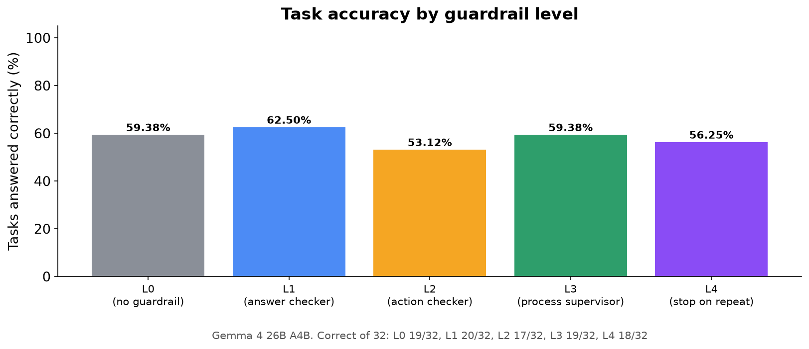
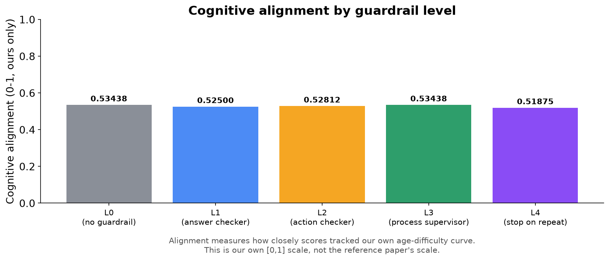
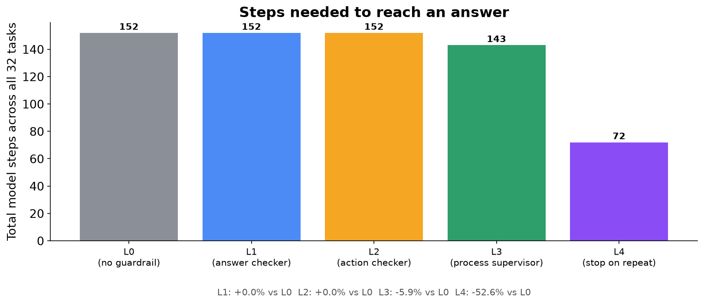
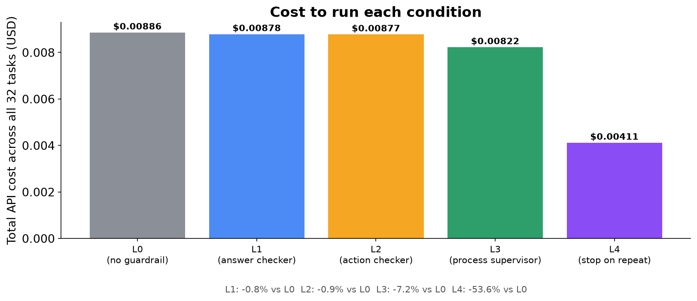
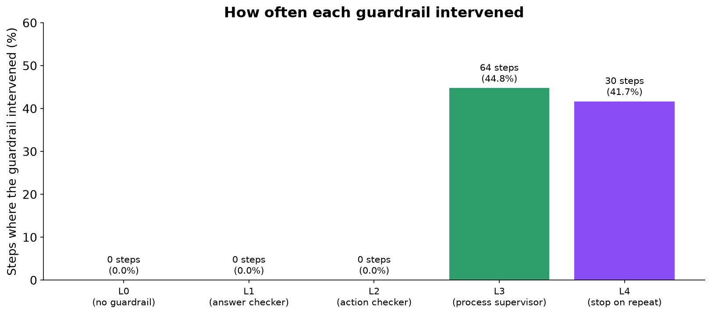
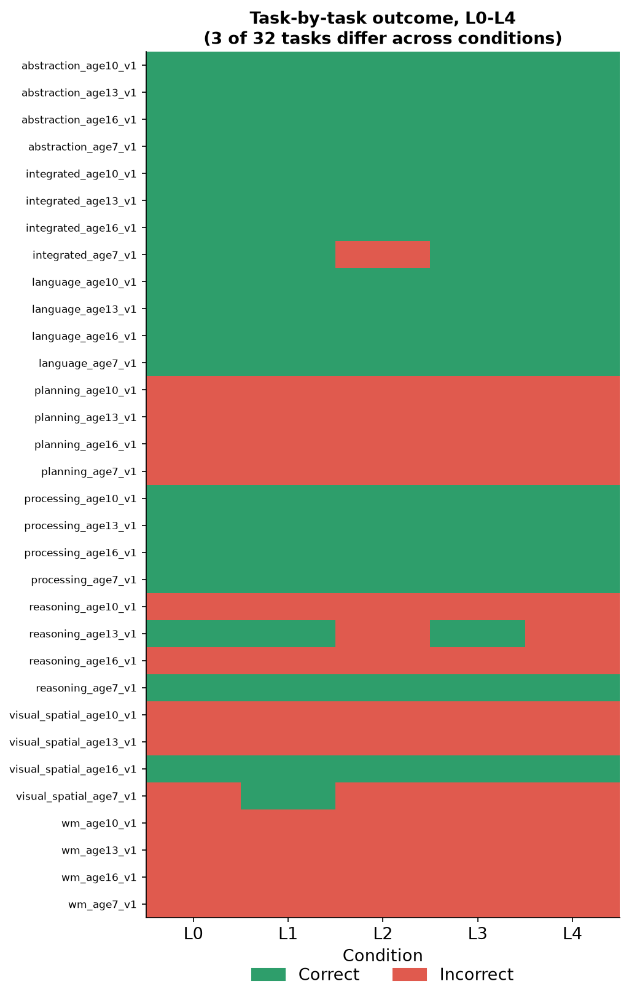
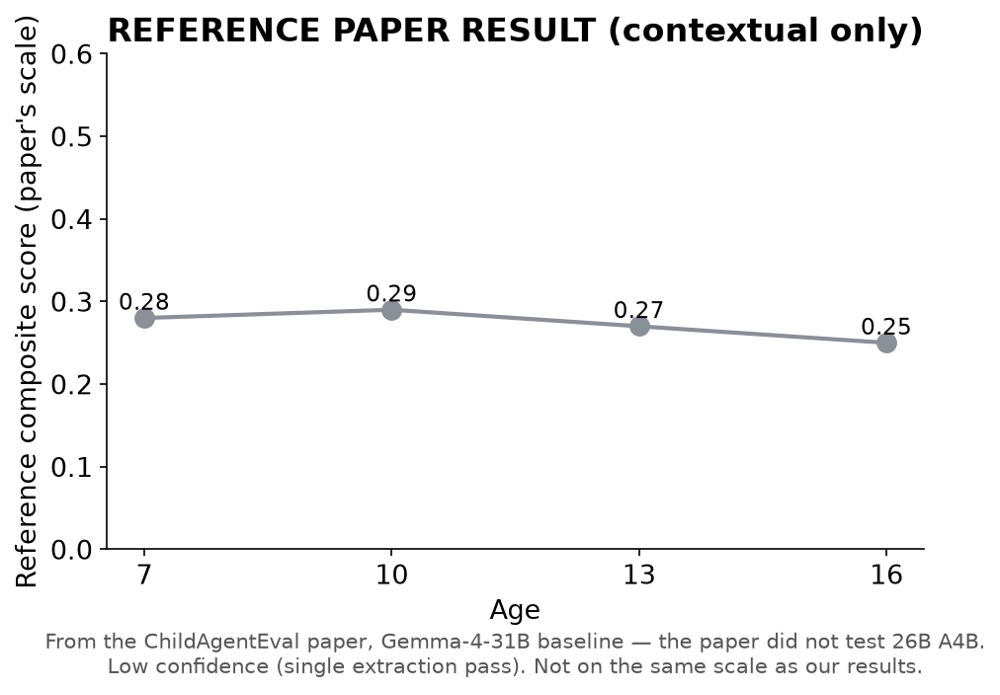
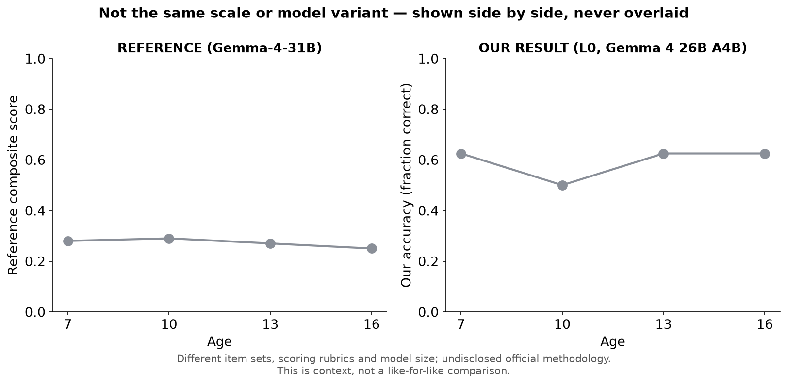
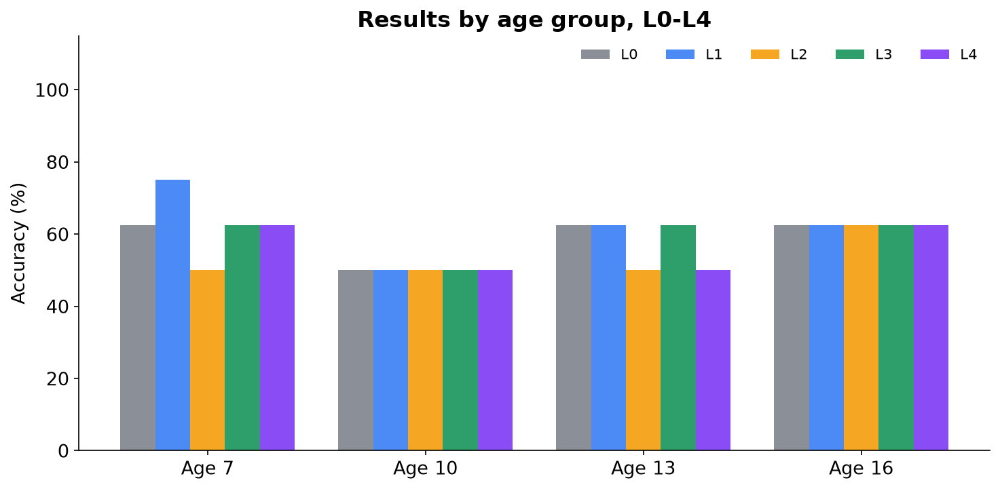
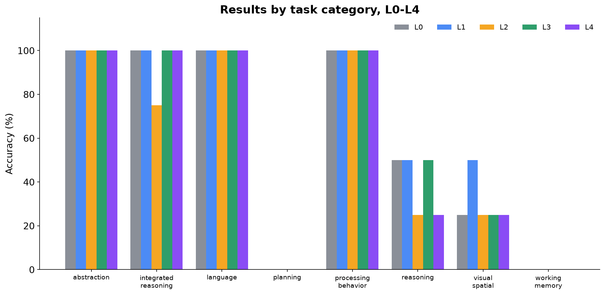

# Can Cognitive Guardrails Change AI Behavior?

### An Experimental Study with Gemma 4 26B A4B — L0 through L4

> This is an **independent, original benchmark** inspired by the publicly described research direction of the ChildAgentEval paper. It is **not a reproduction of ChildAgentEval**: the official benchmark's tasks and scoring were never released publicly. It is the same 32-task benchmark and the same guardrails previously run on Qwen3.5-27B, now run on a second model. Wherever this document shows a number from the original paper, it is marked **REFERENCE PAPER RESULT**.

---

## Page 2 — The Research Question

**Do supervision systems ("guardrails") change what an AI agent actually does, or only how it gets there — and does the answer hold for a second model?**

```
   AI Agent  --works on-->  Task  --produces-->  Behavior
                                                      |
                                      Guardrail watches / intervenes
                                                      |
                                                      v
                                                   Outcome
```

We gave Gemma 4 26B A4B the same 32 tasks and the same five levels of supervision (L0–L4) used for Qwen3.5-27B, and measured what changed: **the answers it gave**, and **the path it took to get there**.

---

## Page 3 — Why This Matters

AI agents are increasingly trusted to click buttons, fill in forms and complete multi-step tasks on their own. If you add a layer that checks the agent's output, its actions, or its overall behaviour, does the agent actually perform better, or does it just look more supervised?

The first study answered this for one model. A finding that holds on only one model could be a quirk of that model, so the second model is the first test of whether it generalises.

> This study repeats the measurement on a second, architecturally different model (a mixture-of-experts model with about 4 billion active parameters per step), under the same controlled conditions.

---

## Page 4 — What We Built

```
 Gemma 4 26B A4B  -->  Browser (Playwright)  -->  32 original tasks
                                                           |
                                        L0 / L1 / L2 / L3 / L4 guardrail layer
                                                           |
                                                           v
                                          Accuracy + Alignment + Cost + Steps
```

- **Model:** Gemma 4 26B A4B (`google/gemma-4-26b-a4b-it`) via OpenRouter, the same settings every run (temperature 0).
- **Environment:** a real Chromium browser, driven step by step by the model through generic click/type/select actions.
- **Benchmark:** the same 32 original tasks as the Qwen study: 8 cognitive categories at 4 target ages (7, 10, 13, 16), one task per category per age. We checked that Gemma saw exactly the same pages Qwen saw, on all 32 tasks.
- **Guardrails:** five supervision conditions, all run and reported together.
- **Measurement:** every step, guardrail decision, token and dollar was logged automatically and scored afterwards.

---

## Page 5 — What Are L0, L1, L2, L3, L4?

Think of them as increasing levels of a supervisor watching someone do a job:

| Level | Analogy | What it actually checks |
|---|---|---|
| L0 | No supervisor | Nothing. The agent works alone. |
| L1 | Answer checker | Rejects malformed or broken output format before it's used. |
| L2 | Action checker | Rejects invalid or clearly premature actions (e.g. giving up on step 1). |
| L3 | Process supervisor | Watches the whole trajectory: if the agent repeats itself, it inserts a pause; after 5 steps it ends the task. |
| L4 | Stop-on-repeat supervisor | Same as L3, except that the moment the agent repeats itself, it ends the task immediately instead of pausing. |

L0 is the plain baseline every other condition is compared against.

> **Guardrail**: an automatic check that inspects an AI agent's output or behaviour and can reject, correct, or redirect it before it counts as final.

---

## Page 6 — How the Experiment Worked

- **32 tasks × 5 conditions (L0–L4) = 160 task runs**, plus a 2-task check run beforehand.
- Every task was run once under each condition, one condition after another.
- Everything was held identical across conditions **except which guardrail was active**: same model, tasks, prompts, temperature, scoring rules and step budget.
- All 160 runs completed in full, with no retries and no interruptions. Total cost: **$0.039**.

> **Trajectory**: the full step-by-step sequence of actions an agent takes while attempting a task.

> **Baseline**: the no-intervention condition (L0) that every other condition is compared against.

---

## Page 7 · Primary Result — Accuracy



### Accuracy moved slightly, but no guardrail caused the movement.

**[Our Result]** L0 got **19 of 32** tasks right, L1 20, L2 17, L3 19 and L4 18. The giveaway is L1 and L2: they **never intervened once**, so the agent under them behaved exactly as under L0, and yet they still scored differently. Those differences can only come from the model itself giving different answers on different runs (see Page 10). The one task L4 lost was a task where L4 never stepped in.

---

## Page 8 · Primary Result — Cognitive Alignment



### No meaningful change in cognitive alignment.

> **Cognitive alignment**: our own measure of how closely an agent's per-age performance tracks the difficulty curve the benchmark was designed around, as a single [0, 1] score. It is **not the same scale or metric as the reference paper's composite score**.

**[Our Result]** Alignment ranged from **0.519 to 0.534** (L0 0.534, L1 0.525, L2 0.528, L3 0.534, L4 0.519). That spread is the same small run-to-run wobble seen in accuracy, not a guardrail effect.

---

## Page 9 · The Interesting Result — L3 and L4: Efficiency







### L4 cut the work roughly in half, the same as it did for Qwen.

**[Our Result]** Only L3 and L4 intervened: **64** and **30** times, almost always because the agent clicked the same button again. Their effect was on *efficiency*:

- L3: steps 152 → 143 (**5.9% fewer**), cost **7.2% lower**
- L4: steps 152 → 72 (**52.6% fewer**), cost $0.00886 → $0.00411 (**53.6% lower**); about half of L3's steps and cost

L1 and L2 recorded **zero** interventions: Gemma never produced broken output or an invalid action, so they had nothing to correct.

---

## Page 10 — Task-by-Task Result



### 29 of 32 tasks had the same result in every condition. The other 3 reflect the model's own variability.

Unlike Qwen, Gemma does not give the same answer every time, even with randomness set to its minimum (temperature 0). On some multiple-choice tasks it changes its mind mid-task, and changes it differently each run. For one reasoning task it clicked `c c d c` in one run and `b c c b` in another. Only the last click counts, so these switches flip the score.

> L0, L1 and L2 are effectively three repeat runs of the same unsupervised agent. Between them, 3 tasks changed result and the score ranged from 17 to 20 out of 32. That is how much a single run of this model can move by chance, and every difference between conditions in this study falls within it.

---

## Page 11 — What Does It Mean?

### What we found

- No guardrail from L1 to L4 changed Gemma's accuracy or alignment by more than the model's own run-to-run variability (paired comparisons, n = 32 tasks, all p ≥ 0.62; 1.0 after correcting for multiple comparisons).
- L4 again roughly halved the steps and cost, as it did for Qwen. That result carried over to the second model.
- Both models score 0% on the planning and working-memory tasks, for the same reason: the agent isn't shown what it already clicked, so it keeps clicking the first item.

### What we cannot claim

> > - We cannot claim guardrails "don't work" in general, only that none of the four tested changed outcomes measurably here. > - We cannot treat these as a reproduction of ChildAgentEval, and the paper never tested this exact Gemma model; the reference numbers are for Gemma-4-31B. > - With one run per condition and a model that varies between runs, a small real effect (a task or two) would be indistinguishable from chance.     

### What we learned

**[Hypothesis]** Gemma's variability most likely comes from OpenRouter routing requests to different servers, which don't guarantee identical output even at temperature 0. This is plausible but not verified.

**[Hypothesis]** Because Gemma sometimes changes its answer mid-task, a guardrail that ends a task early (L3/L4) can, in principle, change which answer counts. That never happened with Qwen. It didn't affect any result in this run, but it means L4 is no longer guaranteed to be outcome-neutral on this model.

---

## Page 12 — Limitations and Next Steps

### Limitations

- One run per condition, on a model whose results vary between runs.
- 32 tasks total (4 per category, 8 per age): limited statistical power.
- L1 and L2 never fired, so their effect on this model is untested, not disproven.
- An original benchmark, not a validated psychometric instrument.
- The reference figures are for a different Gemma variant, at low confidence.

### What to test next

- Repeat each condition several times (cheap: one full L0–L4 pass cost under $0.04) to measure the variability properly and test for real effects.
- Pin a single OpenRouter provider, or set a fixed random seed, to check whether the variability goes away.
- Give the agent its own action history, which would show whether the 0% on planning and working memory comes from the harness or from the model (both models fail identically).
- Run L5 on Gemma once the Qwen L5 design is settled.

> **Closing summary:** on a second model, supervision again changed how efficiently the agent worked without measurably changing what it got right. The new lesson is that this model's own run-to-run variability is as large as any effect we measured, so future comparisons on it need repeated runs.

---

## Appendix — Additional Data

These four figures give context and breakdowns referenced above, using the same real data.

### A1. Reference paper trajectory Reference Paper Result



The paper's Gemma-4-31B baseline composite score by age (arXiv:2605.17894). The paper did not test Gemma 4 26B A4B, so this is a related model, not the one run here, and the values are low-confidence extractions. Context only.

### A2. Reference vs. our L0, side by side



Deliberately shown as two separate panels, not overlaid: different models, item sets and scoring systems. A shared axis would imply they are the same metric.

### A3. Results by age group



Correct of 8: L0 5/4/5/5, L1 6/4/5/5, L2 4/4/4/5, L3 5/4/5/5, L4 5/4/4/5 at ages 7/10/13/16. Ages 10 and 16 are identical across all five conditions.

### A4. Results by task category



Perfect scores in abstraction, language and processing behaviour in every condition (and integrated reasoning in every condition except L2); zero in planning and working memory in every condition. Reasoning (25–50%) and visual-spatial (25–50%) are where the run-to-run variability shows up. Gemma did better than Qwen on reasoning (50% vs 0% at L0) and worse on visual-spatial (25% vs 50%).

---

*Independent Interactive Cognitive-Age Benchmark — not ChildAgentEval · Gemma 4 26B A4B via OpenRouter · Full technical report: benchmark_report.md*
